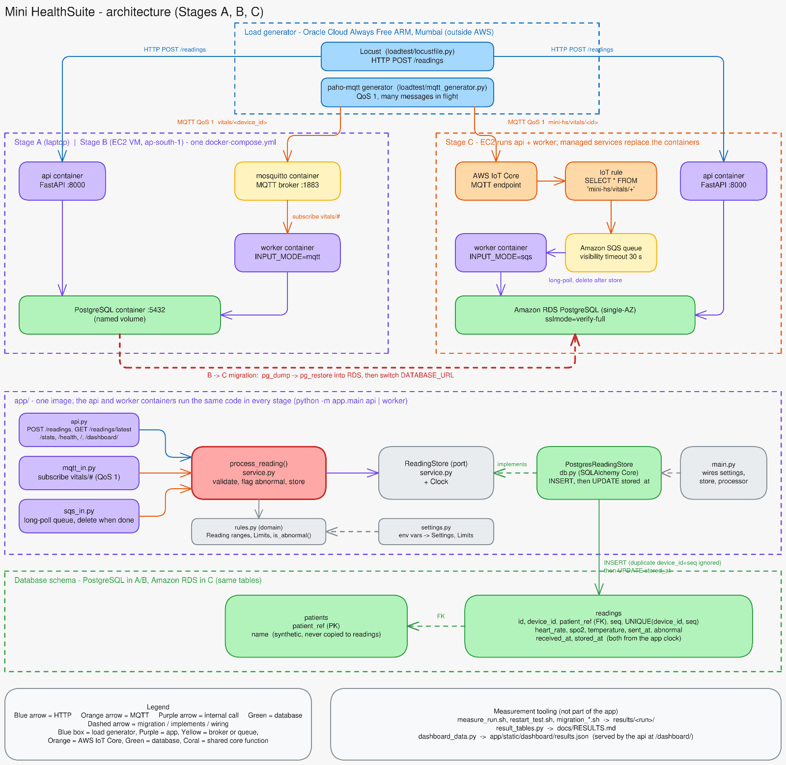
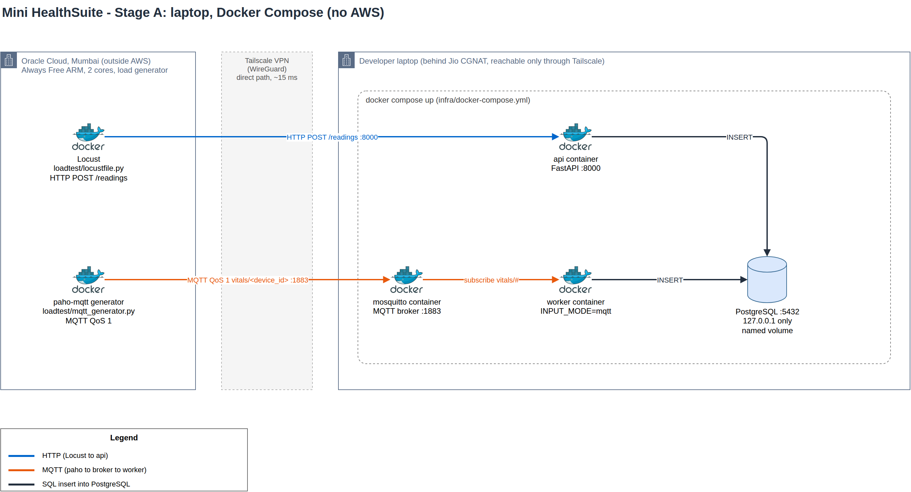
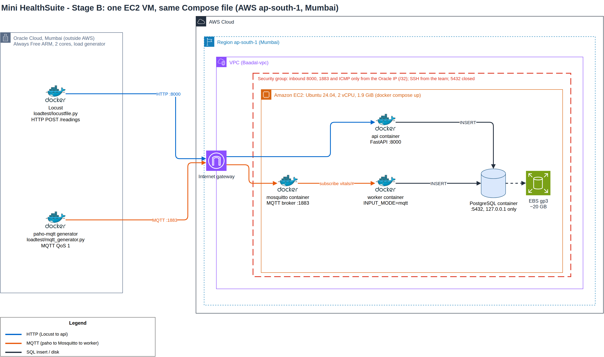
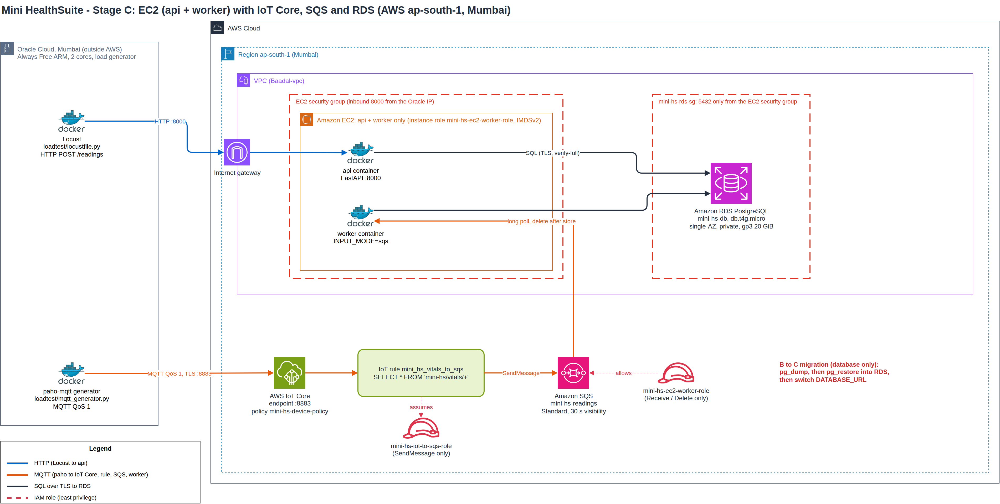

# Mini HealthSuite

**IT457 Cloud Computing, Dhirubhai Ambani University** · 5-week team case study on the Philips HealthSuite Digital Platform (theme: Migration and Transformation)

Philips HealthSuite (HSDP) collects data from connected medical devices on AWS. Philips first moved its own services onto AWS as they were, and later replaced them with AWS-managed services. We wanted to see what those two steps cost in effort, speed and money, so we built a small copy of the idea and measured it.

**Mini HealthSuite** is a small service that receives vital signs (heart rate, SpO2, temperature) from simulated devices, checks them, flags abnormal values and stores them in a database. We built the same app three times and moved it step by step, the way Philips did:

- **Lift-and-shift (A to B):** run the same thing on a cloud machine, change nothing in the code.
- **Refactor (B to C):** swap parts for managed AWS services. Only settings and one input module change.

All readings are synthetic. No real patient data is used anywhere.

## Team

| Name | Student ID |
|---|---|
| Jeet Daiya | 202301017 |
| Kavya Parmar | 202301085 |
| Bhavya Thakkar | 202301169 |

## Architecture

All three stages run the same code in `app/`. A reading arrives over HTTP, MQTT or an SQS queue and goes through one function, `process_reading()`, which validates it, flags abnormal values and stores it. The stages differ only in where the app runs and which services sit around it.



The load generator runs on an Oracle Cloud Always Free instance in Mumbai, outside AWS, so it never runs on a machine that is being migrated.

## The three stages

| Stage | Where it runs | What it shows |
|---|---|---|
| **A** | Laptop, Docker Compose (PostgreSQL and Mosquitto in containers) | Baseline: the app works and is fast with no cloud in the way. |
| **B** | One AWS EC2 VM in Mumbai, same Compose file | Lift-and-shift: same files, new place. Shows what a small VM can and cannot carry. |
| **C** | EC2 plus Amazon RDS, AWS IoT Core and SQS | Refactor: the database and broker become managed services, readings reach the workers through a queue. |

### Stage A



### Stage B



### Stage C



## Main results

Full tables and the reasoning are in [`docs/RESULTS.md`](docs/RESULTS.md). Numbers below are from 3 repeats per setting, 2 minutes each, 0.5 KB messages.

- **Stage A:** server time about 1 ms from 50 to 500 messages/s. The laptop was never busy. Almost nothing lost.
- **Stage B:** nothing lost up to 100 messages/s. At 500 messages/s HTTP overloaded the small VM (about two thirds stored), and MQTT stored everything but about 160 s late because the single worker could not keep up.
- **Stage C:** nothing lost in any run. One worker stores about 104 readings/s; extra workers scale it (2 workers 2.0x, 4 workers 3.6x), and the queue holds the surplus.
- **Migration B to C** (1,000,000 rows, steady 100 messages/s): about 15 s downtime for MQTT with no readings lost, about 25 s for HTTP with about 2,500 readings lost. All data checks passed.
- **Cost:** Stage B about $0.09 for the test window. Stage C about $0.98 for its window, which is $1.55 per million messages, almost all of it IoT Core. The AWS bill matched usage times list price.

## Tests run

| What | Count | Where it ran |
|---|---|---|
| Unit tests (reading rules, service, settings, database, MQTT and SQS input, generators, result tables) | 310 | Laptop |
| API tests (every endpoint, 422 limits, duplicates) | 51 | Laptop |
| Integration tests against a running stack (HTTP and MQTT paths into real PostgreSQL, duplicates, abnormal flag, SQS path) | 13 | Stage B VM: 11 of 11 passed. Stage C VM (RDS and SQS): 9 HTTP and 2 SQS passed, 2 MQTT skipped (no broker in Stage C). |
| Load tests: HTTP (Locust) and MQTT (paho), 10, 50, 100 and 500 messages/s | A 36, B 24, C 12 runs | Generator on Oracle, app on each stage. Stage C is MQTT only. |
| Worker restart test: worker stopped for 20 s at 100 messages/s | 3 runs per stage | A, B and C. Nothing lost in any run. |
| Worker scaling: 500 messages/s with 2 and 4 workers (the 1-worker runs are in the matrix) | 6 runs | Stage C |
| B to C migration test: 1,000,000 rows, `pg_dump` and `pg_restore` to RDS under steady load | 6 runs (HTTP and MQTT) plus a pilot | Stage B to C |

The local suite passes with `pytest` (361 passed; the 13 integration tests are skipped unless a stack is running).

## Contributions

This is a short summary. The detailed per-task log with times and problems is in [`docs/EFFORT_LOG.md`](docs/EFFORT_LOG.md).

| Area | Jeet | Kavya | Bhavya |
|---|---|---|---|
| **Project setup and app** | Project structure, design and team split, app core (service, database, API, main) | MQTT worker input, Docker Compose stack | Split reading rules and settings into their own modules |
| **Load generators** | Oracle load-generator setup and Tailscale link to the laptop | paho-mqtt generator and stub broker | Locust HTTP generator |
| **Stage A** | Integration tests, measured runs, restart test | Local end-to-end check | |
| **Stage B** | AWS console and security group, restart test, investigation of the 500 messages/s results | EC2 setup and deployment, measured runs (24) | |
| **Stage C** | SQS worker input, integration tests | AWS setup (RDS, SQS, IoT Core, IAM), Compose file for Stage C, Stage C generator and run scripts | Measured runs (21), CloudWatch checks, cost check and findings |
| **Migration B to C** | Migration scripts, runs and results | | |
| **Dashboard** | | Results dashboard at `/dashboard/` | |
| **Docs and results** | Results tooling and `docs/RESULTS.md`, architecture doc | Stage B findings | Stage C findings and cost |
| **Week 4 report** | | LaTeX report of the measured results (results, plan versus what we did, problems, cost), charts and tables generated from `results/` | |

**Report.** Roles as agreed in the Week 2 report (Table XXI). Jeet leads the build and the cost model, and checks that each section matches what was built.

| Member | Report sections |
|---|---|
| Jeet Daiya | III (assumed HSDP architecture), IV (cost analysis, except the on-premises costing), V (exercise plan) |
| Kavya Parmar | III, IV-C (on-premises costing), V-D (experiment plan), price and calculation tables in the appendix |
| Bhavya Thakkar | II (case study: Philips HSDP), III, reference list |

The reports are in [`docs/reports`](docs/reports): Week 1 (case summary), Week 2 (case analysis, cost model and exercise plan) and Week 4 (measured results).

## Run it

Replace `<key>`, `<ec2-ip>` and `<oracle-ip>` with your own values. They are not kept in the repo.

**Application** (Stage A on any machine with Docker, or Stage B on the VM):

```bash
cp .env.example .env
docker compose --env-file .env -f infra/docker-compose.yml up --build -d
curl localhost:8000/health        # {"status":"ok"}
docker compose --env-file .env -f infra/docker-compose.yml down   # stop
```

The API is on port 8000 (`/` form, `/readings/latest`, `/stats`, `/health`, `/dashboard/`) and MQTT on 1883. Stage C uses `infra/docker-compose.stage-c.yml` with the RDS and SQS values in `.env`. Setup for B and C is in [`docs/DEPLOYMENT.md`](docs/DEPLOYMENT.md).

**SSH:**

```bash
ssh -i <key> ubuntu@<ec2-ip>      # EC2 VM (Stages B and C)
ssh -i <key> ubuntu@<oracle-ip>   # Oracle load-generator box
```

**Load generator.** On the Oracle box, build once, then run by hand:

```bash
cd ~/it457-loadgen
docker build -f loadtest/Dockerfile -t it457-loadgen .
RUN="docker run --rm --network host --user $(id -u):$(id -g) \
  -v $PWD/loadtest:/work/loadtest:ro -v $PWD/results:/work/results \
  -v $PWD/calibration:/work/calibration it457-loadgen"

$RUN ./loadtest/run_http.sh <stage> <rate> <repeat> http://<app-host>:8000
$RUN ./loadtest/run_mqtt.sh <stage> <rate> <repeat> <broker-host>
```

Or run a full measured run from your laptop. It drives both machines over SSH and collects the results:

```bash
ORACLE=ubuntu@<oracle-ip> ORACLE_KEY=<key> APP=ubuntu@<ec2-ip> APP_KEY=<key> \
  ./loadtest/measure_run_remote.sh <http|mqtt> <rate> <repeat>
```

For Stage C (MQTT only), add `STAGE_C=1 IOT_ENDPOINT=<iot-endpoint> IOT_CERT_DIR=/home/ubuntu/iot-certs IOT_CA=AmazonRootCA1.pem IOT_CERT=device.crt IOT_KEY=device.key` in front. Rates used are 10, 50, 100 and 500 messages/s. More options are in [`loadtest/README.md`](loadtest/README.md). Stop the EC2 VM and RDS after every session, because they cost money while running.

## Repository layout

| Folder | Contents |
|---|---|
| `app/` | The service (FastAPI, MQTT and SQS inputs, database, rules) and the dashboard page |
| `infra/` | Docker Compose files for the stages and the migration test, Dockerfile, Mosquitto config |
| `loadtest/` | Load generators, measured-run and migration scripts, result tables |
| `tests/` | Unit, API and integration tests |
| `results/` | Run summaries and statistics (raw run folders are archived in the team Drive) |
| `docs/` | Architecture, results, deployment, gotchas, changelog, effort log, reports, diagrams |

## Documents

| Document | What it covers |
|---|---|
| [`docs/ARCHITECTURE.md`](docs/ARCHITECTURE.md) | Layers, interfaces, database schema |
| [`docs/API.md`](docs/API.md) | HTTP endpoints, MQTT input, reading format and limits |
| [`docs/RESULTS.md`](docs/RESULTS.md) | Measured results and findings per stage |
| [`docs/DEPLOYMENT.md`](docs/DEPLOYMENT.md) | What runs where, setup steps, environment variables |
| [`docs/GOTCHAS.md`](docs/GOTCHAS.md) | Problems we hit and how to avoid them |
| [`docs/EFFORT_LOG.md`](docs/EFFORT_LOG.md) | Hands-on time and manual steps per task |
| [`docs/CHANGELOG.md`](docs/CHANGELOG.md) | Dated log of what was finished |
